# CareBridge — Architecture

> A chat-first care assistant for caretakers of elderly patients. Every todo, log, and answer is grounded in **Hindsight** persistent memory, so the agent gets measurably better at caring for each patient over time — and any caretaker can pick up where the last one left off.

**Status:** Build spec for a single-pass implementation with Claude Code.
**Data:** Synthetic patients only.

---

## 1. Product scope

### 1.1 What we are building

| Surface | User | Purpose |
| --- | --- | --- |
| **Enrollment** | Patient (self) or family/caretaker | Large-text, 5-step form: identity, contact, health basics, medications & allergies, routines |
| **Caretaker dashboard** | Caretaker | One Kanban of today's todos across **all** assigned patients, ordered by the orchestrator |
| **Chat agent** | Caretaker | Log care in plain language, confirm todos, ask handoff questions, get suggestions |
| **Patient profile** | Caretaker / coordinator | Health record, timeline, memory evidence, trend alerts |
| **Coordinator view** (light) | Coordinator | Verify self-enrolled medical data, receive escalations, assign patients |

### 1.2 Workflows in scope

| # | Workflow | Hindsight features used |
| --- | --- | --- |
| W1 | Patient enrollment | `create_bank` (mission + directives), first `retain` |
| W2 | Daily todo generation | `recall` (routines), mental model "Routine & timing" |
| W3 | Chat todo check-in (Completed / Not done / Skipped) | `retain` with outcome + reason |
| W4 | Chat care logging (meds & effects, progress, sleep, diet, allergies, mood) | `retain` structured facts, entity linking |
| W5 | Handoff Q&A for a new caretaker | `reflect` with citations, `recall` with temporal window |
| W6 | **"What worked before"** suggestions | Observations (consolidated, evidence-grounded), `reflect` |
| W7 | **Learning why todos fail** → reschedule proposals | Observations over repeated failures, mental model update |
| W8 | **Trend watch with escalation** (never diagnosis) | Temporal `recall` over a window, observation history |
| W9 | **Cross-patient orchestration** of the caretaker's Kanban | `recall` across each assigned patient's bank, mental models |

### 1.3 Safety boundary (non-negotiable)

CareBridge **does not diagnose, prescribe, change doses, or infer medical causes.**

- Medication todos come **only** from verified medication records in PostgreSQL.
- Hindsight memory can enrich context ("she takes it better with warm water") but never creates, removes, or alters a medication instruction.
- Trend alerts describe *what was observed* and recommend *who to contact*, never *why it is happening*.
- Learned suggestions are always labeled **"Observed pattern — not a clinical instruction"** and show evidence (date, caretaker, reason, outcome).

---

## 2. Design principles

1. **Two sources of truth, clearly split.** PostgreSQL = authoritative records (identity, care plan, medications, todos, assignments). Hindsight = learned context (what happened, what helped, why things failed, how patterns are shifting).
2. **Memory is visible.** Every agent answer that uses memory shows a "Memory used" chip with the evidence behind it.
3. **One bank per patient.** Fully isolated. The backend derives the bank ID from the authorized patient — never from client input.
4. **Write-through.** Every confirmed chat action writes to PostgreSQL first, then retains to Hindsight. The UI never talks to Hindsight or the LLM directly.
5. **The agent proposes, the human confirms.** Status changes, reschedules, and escalations are offered as buttons; nothing clinical is auto-applied.

---

## 3. System context

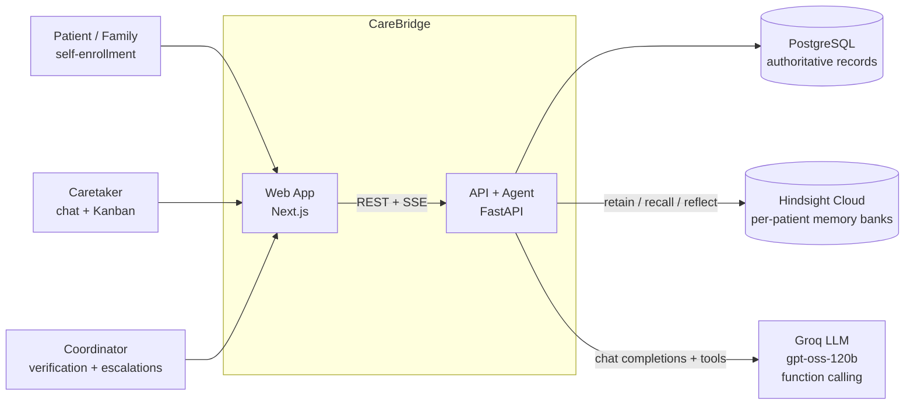

---

## 4. Container architecture

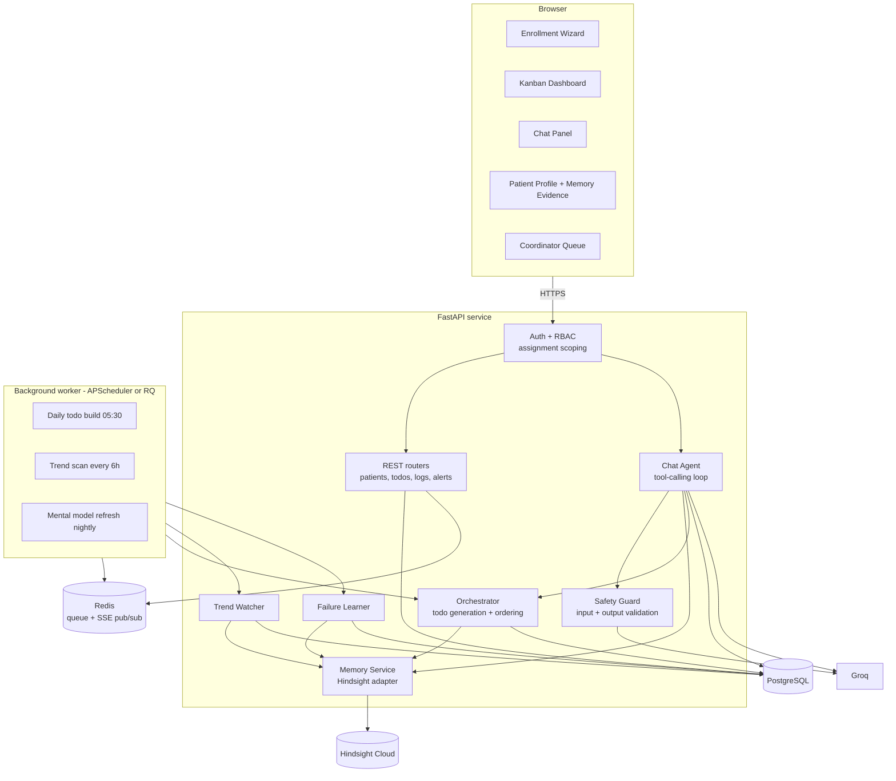

### 4.1 Backend modules

| Module | Responsibility |
| --- | --- |
| `auth` | Session/JWT, role resolution, `require_assignment(patient_id)` dependency |
| `patients` | Enrollment, profile, verification state of medical data |
| `todos` | Todo CRUD, status transitions, daily instances |
| `logs` | Structured care logs (meds, sleep, diet, mood, mobility, progress, allergy, observation) |
| `memory` | **Only** module that imports `hindsight_client`. Bank creation, retain, recall, reflect, mental models |
| `agent` | Chat loop, tool registry, prompt assembly, SSE streaming |
| `guard` | Safety checks on user input and LLM output (dose language, diagnosis language, uncited suggestions) |
| `orchestrator` | Builds daily todos per patient and orders the caretaker's combined board (W2, W9) |
| `learning` | Failure-reason learning and reschedule proposals (W7) |
| `trends` | Windowed trend detection and escalation alerts (W8) |
| `alerts` | Escalations to coordinator, acknowledgement tracking |

---

## 5. Data model (PostgreSQL)

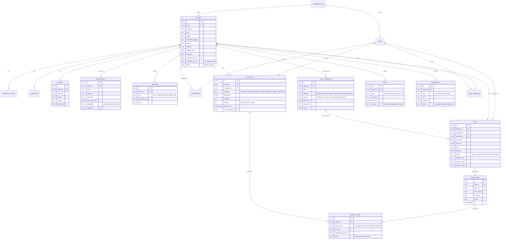

---

## 6. Hindsight memory design

### 6.1 Bank per patient

```
bank_id = f"cb-{org_slug}-patient-{patient_uuid}"
```

Created during enrollment (W1). Stored in `patients.hindsight_bank_id`. Never accepted from the client.

**Bank configuration**

```python
client.create_bank(
    bank_id=bank_id,
    name=f"Care memory — {patient.full_name}",
    mission=(
        "I am the care memory for one elderly patient. I remember routines, "
        "preferences, what caretakers did, what helped, what did not, and why "
        "tasks were missed, so any caretaker can continue care seamlessly. "
        "I prioritise recent, repeatedly confirmed observations."
    ),
    disposition={"skepticism": 4, "literalism": 4, "empathy": 4},
)
# Directives (hard rules for reflect)
#  - Never diagnose, prescribe, estimate or change a medication dose.
#  - Never infer a medical cause for a symptom or trend.
#  - Always state learned patterns as observations with dates and caretakers.
#  - If evidence is thin or conflicting, say so and point to the care plan or coordinator.
```

### 6.2 What gets retained

Every retain is **factual, attributed, timestamped**, and linked to its PostgreSQL source via `document_id` and `metadata`.

| Source | Example content retained | `context` | `metadata` |
| --- | --- | --- | --- |
| Enrollment | "Asha Rao, 78, female. Prefers Telugu. Uses a walker. Wakes ~6:30 AM, walks after dinner." | `enrollment` | `{source_type, source_id}` |
| Todo check-in | "On 6 Nov 2026 at 08:10, caretaker Anjali marked 'Morning bath' NOT DONE. Reason: Asha refused, said she feels cold in the morning." | `todo_outcome` | `{todo_id, category, status, caretaker_id}` |
| Care log — medication | "6 Nov 2026 08:00 — Metformin given by Anjali with breakfast. Observed: mild nausea for ~30 minutes, settled after rest." | `medication_effect` | `{log_id, medication_id}` |
| Care log — sleep | "Night of 5 Nov 2026: slept ~5 hours, woke twice. Reported by Rohan." | `sleep` | `{log_id}` |
| Care log — diet | "6 Nov 2026 dinner: ate half a portion of rice and dal, refused curd." | `diet` | `{log_id}` |
| Care log — mood | "6 Nov 2026 evening: restless after dinner; a 10-minute assisted walk calmed her and she slept through." | `intervention_outcome` | `{log_id}` |
| Allergy report | "Caretaker Rohan reported a rash after a new soap on 3 Nov 2026 (pending verification)." | `allergy_report` | `{log_id, verification: pending}` |

**Never retained:** raw chat chit-chat, LLM speculation, diagnoses, dose suggestions, other patients' data.

### 6.3 What gets read back

| Need | Hindsight call | Notes |
| --- | --- | --- |
| Handoff question | `reflect(bank, query, budget="mid")` | Answer + cited memory IDs → evidence cards |
| Context for a chat turn | `recall(bank, query, types=["world","experience","observation"], max_tokens=2048)` | Injected into the agent prompt as "Memory evidence" |
| "What worked before" | `recall(..., types=["observation"])` + `reflect` | Observations carry proof count and evidence |
| Why todos fail | `recall(bank, "why was <todo title> not done", types=["observation","world"])` | Repeated reasons consolidate into an observation |
| Trend window | `recall(bank, "sleep last 7 days", ...)` with temporal phrasing | Hindsight parses the time window |
| Orchestration constraints | Mental model `routine-and-timing` per patient | Curated summary refreshed nightly |

### 6.4 Mental models per patient

| Mental model | Question it answers | Used by |
| --- | --- | --- |
| `routine-and-timing` | "What times and conditions does this patient need for each daily activity?" | W2, W7, W9 |
| `what-helps` | "Which caretaker actions reliably help this patient, and in what situations?" | W6 |
| `handoff-essentials` | "What must a new caretaker know before the next shift?" | W5 |

### 6.5 Memory lifecycle

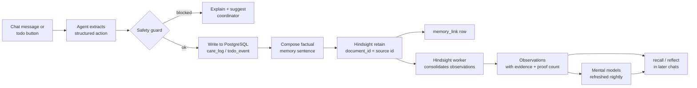

---

## 7. Chat agent design

### 7.1 Loop

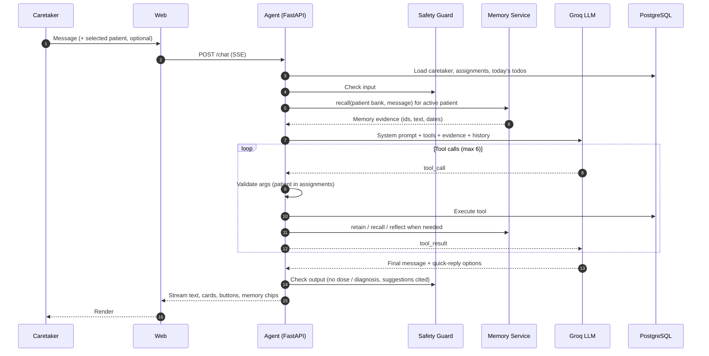

### 7.2 Tools exposed to the LLM

| Tool | Args | Effect |
| --- | --- | --- |
| `list_todos` | `patient_id?`, `status?` | Today's todos for the caretaker |
| `update_todo_status` | `todo_id`, `status`, `reason?` | Writes `todo_event`, retains outcome (W3) |
| `log_care` | `patient_id`, `category`, `structured`, `narrative`, `severity`, `observed_at` | Writes `care_log`, retains fact (W4) |
| `report_allergy` | `patient_id`, `substance`, `reaction` | Creates **pending** allergy + coordinator alert |
| `recall_memory` | `patient_id`, `query`, `types?` | Returns evidence list |
| `ask_memory` | `patient_id`, `question` | `reflect` answer + citations (W5) |
| `what_worked` | `patient_id`, `situation` | Observation-backed suggestions (W6) |
| `propose_reschedule` | `todo_template_id`, `new_time`, `evidence_ids` | Creates a `suggestion` the caretaker accepts (W7) |
| `raise_escalation` | `patient_id`, `summary`, `evidence_ids` | Creates alert to coordinator (W8) |
| `get_patient_profile` | `patient_id` | Authoritative profile, meds, allergies, routines |

The agent **cannot** create or edit medication records. There is no tool for it.

### 7.3 System prompt (core)

```text
You are CareBridge, an assistant for home caretakers of elderly patients.
You help caretakers log care, track todos, and continue care across handoffs.

Rules:
- Use tools for every fact about a patient. Never invent facts.
- Do not diagnose, prescribe, estimate or change medication doses, or explain medical causes.
- When you use memory, cite each item as (date, caretaker). Label learned patterns
  "Observed pattern — not a clinical instruction".
- If evidence is thin or conflicting, say so and suggest following the care plan or
  contacting the coordinator.
- When a log describes urgent signs (fall, chest pain, breathing difficulty, unresponsive),
  tell the caretaker to follow the emergency rule and call emergency services or the
  coordinator now, and raise an escalation.
- Keep messages short. Offer quick-reply options when the caretaker must choose.
- Always resolve which patient a message is about. If ambiguous, ask with patient buttons.
```

### 7.4 Message rendering contract

The agent's final payload is structured so the UI can render rich components:

```json
{
  "text": "Morning bath for Asha is marked not done. This is the 3rd morning in a row.",
  "cards": [
    {"type": "suggestion", "kind": "reschedule", "id": "sug_12",
     "title": "Move Asha's bath to 1:30 PM?",
     "evidence": [{"date": "2026-11-04", "caretaker": "Rohan", "text": "Refused, said water felt cold"}]}
  ],
  "quick_replies": [
    {"label": "Yes, move it", "action": "accept_suggestion", "id": "sug_12"},
    {"label": "Keep morning", "action": "dismiss_suggestion", "id": "sug_12"}
  ],
  "memory_used": [{"id": "mem_a1", "date": "2026-11-04", "caretaker": "Rohan"}]
}
```

---

## 8. Workflows in detail

### W1 — Patient enrollment

**Form steps** (one question group per screen, large text, big buttons, progress bar, autosave, voice-friendly labels):

1. **About you** — full name, age, gender, preferred language
2. **Contact** — phone, address, emergency contact (name, relation, phone)
3. **Health basics** — conditions (chips + "other"), mobility (walks alone / with stick / with walker / wheelchair / bedbound), diet (veg / non-veg / diabetic / soft food), hearing & vision
4. **Medicines & allergies** — name, when taken (morning / afternoon / night chips), allergies
5. **Daily routine** — wake time, meal times, sleep time, likes (walks, prayer, TV, music)

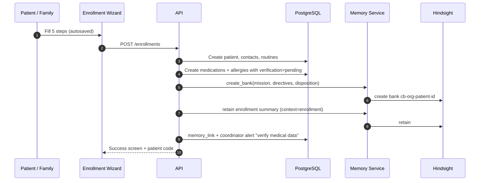

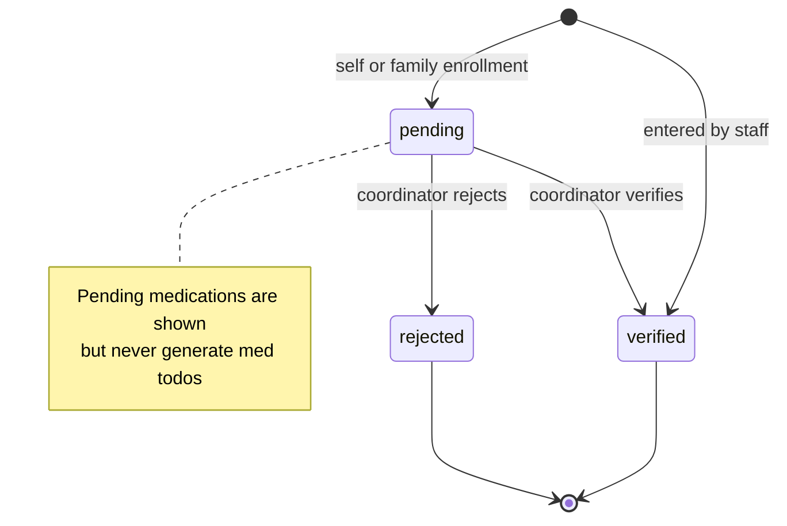

### W2 — Daily todo generation

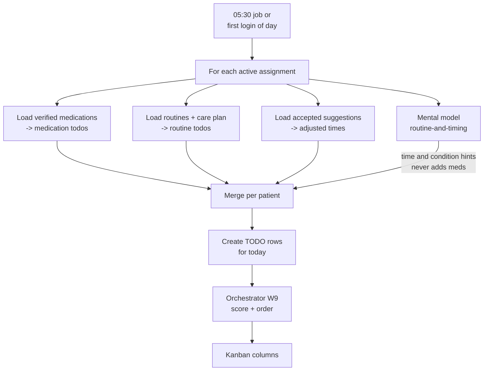

### W3 — Chat todo check-in

The agent proactively checks in when a todo's due time passes (and on chat open).

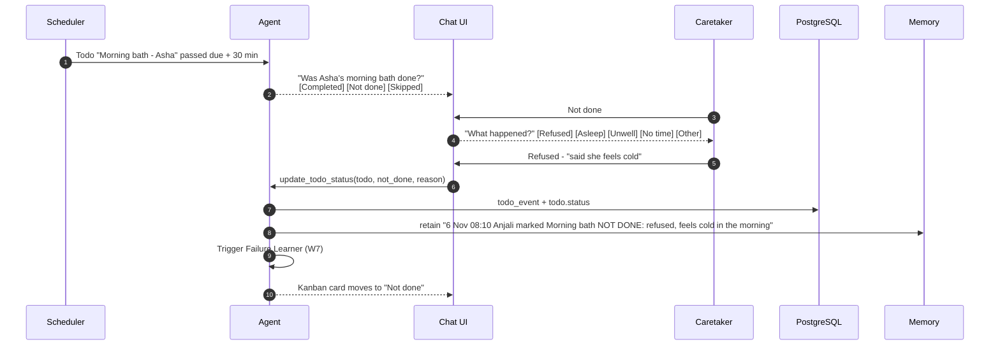

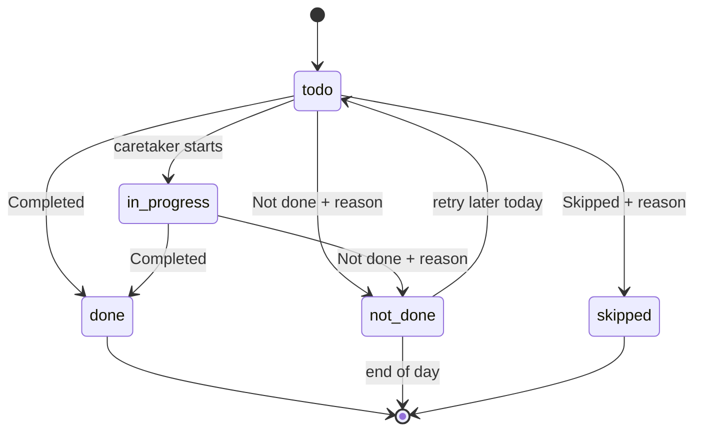

### W4 — Chat care logging

Caretaker types freely: *"Gave Asha her metformin at 8 with breakfast, she felt a bit nauseous for half an hour. Slept badly last night, maybe 5 hours. Ate only half her dinner."*

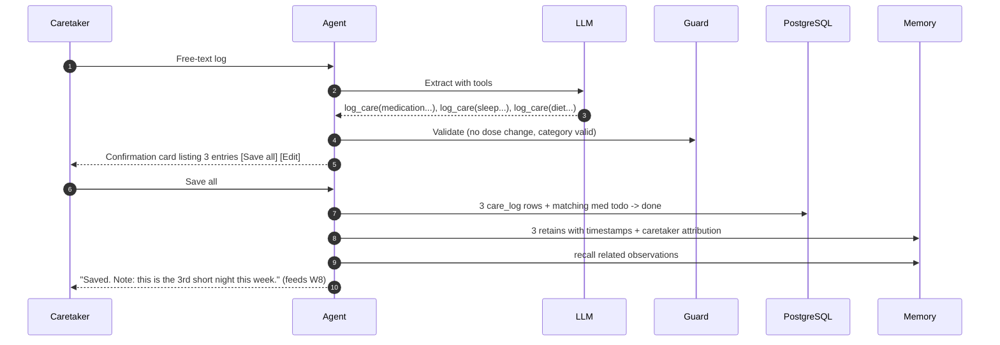

Log categories and structured fields:

| Category | Structured fields |
| --- | --- |
| medication | medication_id, status (given / missed / refused / held), time, observed_effects |
| sleep | hours, wake_ups, quality (good / fair / poor) |
| diet | meal, portion (full / half / little / none), fluids_ml, refused_items |
| mood | mood (calm / happy / low / anxious / restless / confused), triggers, what_helped |
| mobility | assistance level, falls (bool), notes |
| progress | area (walking, speech, appetite, independence), change (better / same / worse) |
| allergy | substance, reaction → **pending** + coordinator alert |
| observation | free text, severity |

### W5 — Handoff Q&A

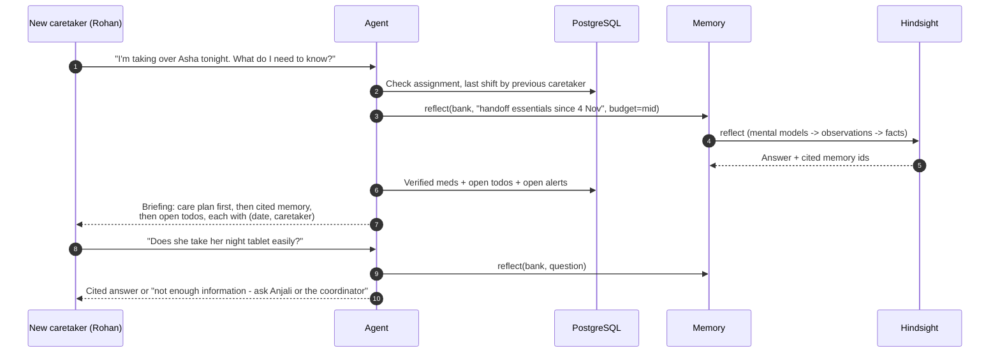

### W6 — "What worked before"

Hindsight's observation consolidation turns repeated facts like *"restless after dinner → assisted walk → calmed"* into a single observation with a proof count.

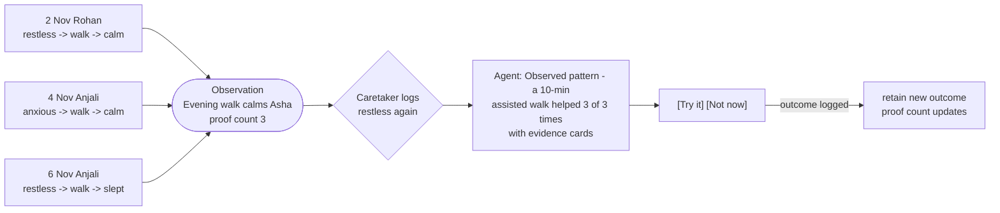

Trigger: any mood / sleep / diet log with severity `watch`, or the caretaker asks "what usually helps?". Display rules: only observations with ≥2 supporting facts from ≥1 caretaker in the last 30 days; never shown if it contradicts the care plan.

### W7 — Learning why todos fail

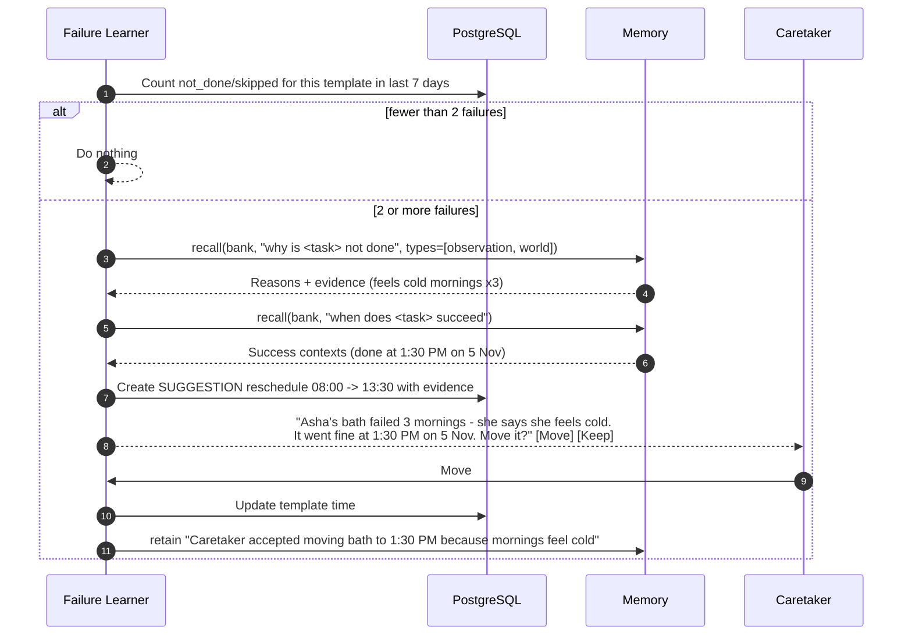

Medication todos are **excluded** from automatic reschedule proposals; for them the learner suggests "discuss timing with the coordinator / doctor".

### W8 — Trend watch with escalation

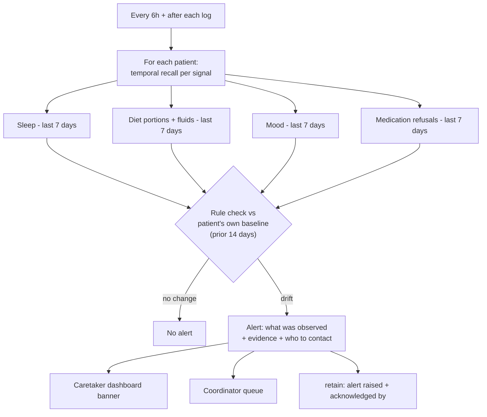

Rules (deterministic, computed from PostgreSQL logs; Hindsight supplies the narrative evidence and the patient's baseline observations):

| Signal | Rule | Alert text example |
| --- | --- | --- |
| Sleep | avg hours last 3 nights ≤ baseline − 1.5h | "Sleep shorter than usual on 3 of the last 3 nights (≈5h vs ≈7h)." |
| Diet | ≥3 of last 5 meals half portion or less | "Reduced dinner intake on 4 of the last 5 days." |
| Mood | ≥3 low / anxious / confused logs in 5 days | "Low or anxious mood logged 3 times in 5 days." |
| Medication | ≥2 refusals of the same medicine in 7 days | "Metformin refused twice this week." |

Every alert ends with: *"This is an observation, not a diagnosis. Please inform the coordinator or doctor."*

### W9 — Cross-patient orchestration

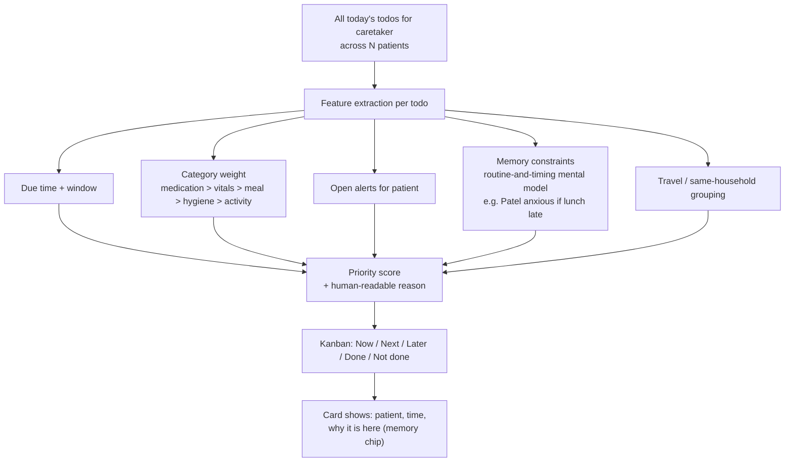

Scoring (deterministic, explainable):

```
score = time_urgency(0-40) + category_weight(0-25) + alert_boost(0-20) + memory_constraint_boost(0-15)
column = Now   if due within 60 min or overdue
         Next  if due within 3 h
         Later otherwise
```

`memory_constraint_boost` comes from the mental model output (parsed to structured hints nightly and cached in Redis), so the board is fast and doesn't call the LLM at render time.

---

## 9. API contract (base `/api/v1`)

| Method | Route | Role | Purpose |
| --- | --- | --- | --- |
| POST | `/auth/demo-login` | any | Pick a demo user (hackathon) |
| POST | `/enrollments` | public / staff | Create patient + bank (W1) |
| GET | `/patients/{id}` | assigned | Profile, meds, allergies, routines |
| GET | `/patients/{id}/timeline` | assigned | Logs + todo events |
| GET | `/patients/{id}/memory` | assigned | Recent memories + observations with evidence |
| GET | `/me/board?date=` | caretaker | Orchestrated Kanban (W9) |
| PATCH | `/todos/{id}` | assigned | Status change from Kanban drag (same path as W3) |
| POST | `/chat` | caretaker | SSE stream of agent turn |
| GET | `/chat/history?patient_id=` | caretaker | Messages |
| POST | `/suggestions/{id}/accept` · `/dismiss` | assigned | W6 / W7 |
| GET | `/alerts` · POST `/alerts/{id}/ack` | caretaker / coordinator | W8 |
| GET | `/coordinator/verifications` | coordinator | Pending meds & allergies |
| POST | `/coordinator/verifications/{id}` | coordinator | Verify / reject |
| POST | `/demo/memory-toggle` | demo only | Answer the same question with memory off vs on |

---

## 10. Deployment

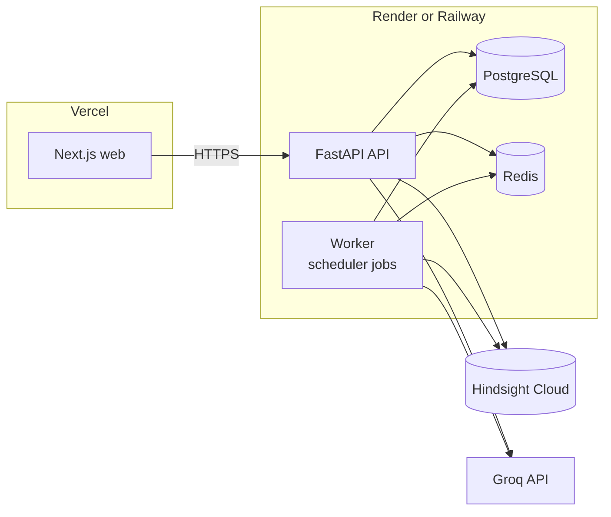

Local: `docker compose up` → postgres, redis, api, worker, web. Hindsight Cloud by default (`HINDSIGHT_BASE_URL`, `HINDSIGHT_API_KEY`); optional local Hindsight container for offline dev.

---

## 11. Security & privacy

- Every patient route depends on `require_assignment(patient_id)`; coordinators are org-scoped.
- Bank IDs derived server-side only.
- Hindsight and Groq keys server-side only.
- Audit table for reads of patient profile/memory, verifications, and escalations.
- Synthetic data only in demos and screenshots.

---

## 12. Demo story (3 minutes)

| Step | Show | Hindsight moment |
| --- | --- | --- |
| 1 | Mrs. Asha Rao self-enrolls in 5 big screens | Bank created, first memory retained |
| 2 | Anjali's Kanban: 3 patients, ordered with reasons | W9 — "Mr. Patel lunch first: gets anxious if late (observed 4×)" |
| 3 | Chat: "Was Asha's bath done?" → Not done → Refused, cold | W3 retain → W7 proposal "move to 1:30 PM" |
| 4 | Anjali logs: restless after dinner | W6 — "Evening walk helped 3 of 3 times" with evidence |
| 5 | Trend banner: short sleep 3 nights | W8 — observation + "inform coordinator" |
| 6 | Switch to Rohan: "Taking over Asha tonight — what should I know?" | W5 — cited briefing from Anjali's logs |
| 7 | Memory toggle: same question, memory off vs on | Before/after for judges |

---

## 13. Test checklist

- [ ] Unassigned caretaker gets 403 on patient, chat, memory routes.
- [ ] Pending (unverified) medications never produce todos.
- [ ] Agent has no tool path to create/modify medications.
- [ ] Guard blocks outputs containing dose changes or diagnoses.
- [ ] Every W6 suggestion includes ≥2 evidence items with date + caretaker.
- [ ] W7 never proposes reschedule for medication todos.
- [ ] W8 alerts contain the "not a diagnosis" line and evidence.
- [ ] Todo status from Kanban drag and from chat produce identical `todo_event` + retain.
- [ ] Retain failure is retried and visible in `memory_link.status`.
- [ ] Fresh seed reproduces the full demo story.
